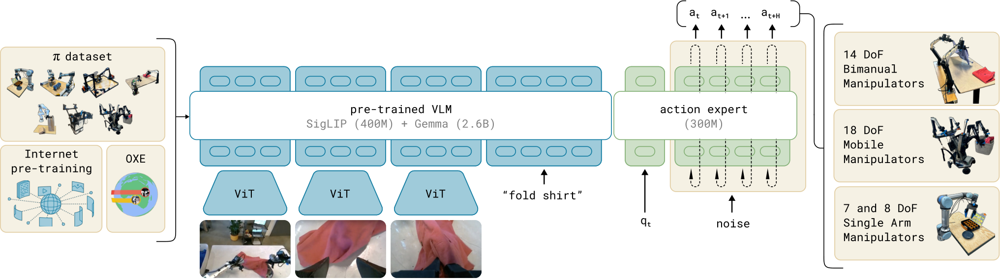
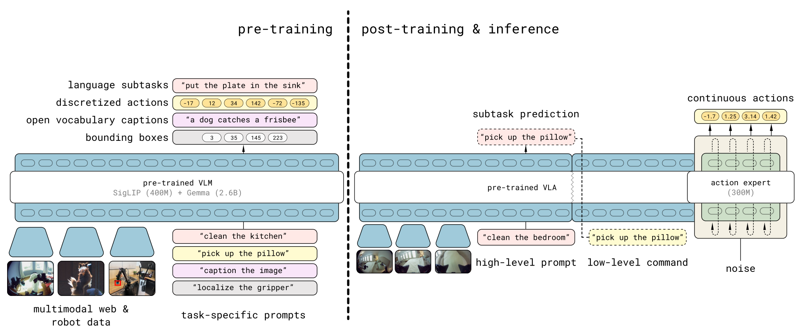

# 1.两阶段推理
在推理阶段，模型首先推断一个高级子任务，然后基于该子任务预测动作
# 2.PI系列阅读
| 顺序 | 文章 | 阅读重点 | 重要程度 |
|---|---|---|---|
| 1 | π0 | VLA 架构、Flow Matching、Action Expert | ★★★★★ |
| 2 | FAST | DCT、BPE、动作 Token 化 | ★★★★ |
| 3 | Hi Robot | 高低层推理、任务分解 | ★★★★ |
| 4 | π0.5 | 异构数据、泛化、训练方法 | ★★★★★ |
| 5 | Knowledge Insulation | VLM 与 Action Expert 的训练关系 | ★★★★ |
| 6 | RTC | Action Chunk 执行机制 | ★★★ |
| 7 | π*0.6 | RECAP、Value Function、Advantage | ★★★★ |
| 8 | MEM | 长短期记忆机制 | ★★★ |
| 9 | Human-to-Robot Transfer | 人类数据迁移 | ★★★ |
| 10 | RLT | 在线强化学习 | ★★★ |
| 11 | π0.7 | 多模态条件控制、组合泛化 | ★★★★ |
# PI0.5
## 1.预训练
FAST动作标记器
```
连续动作序列
      ↓
数据归一化
      ↓
离散余弦变换（DCT）
      ↓
频域系数量化
      ↓
展平成整数序列
      ↓
BPE 压缩
      ↓
离散 Action Tokens
```
PI 0三段式因果掩码
diffusion和flowmatching
数据使用过程中数据加权目的
DCT变换
视觉编码器
PI0 state encoder
$$
X_k = \alpha(k) \sum_{n=0}^{N-1} x_n
\cos\left[\frac{\pi}{N}\left(n+\frac{1}{2}\right)k\right]
$$


RCT
https://huggingface.co/docs/lerobot/main/rtc
https://arxiv.org/html/2506.07339v2