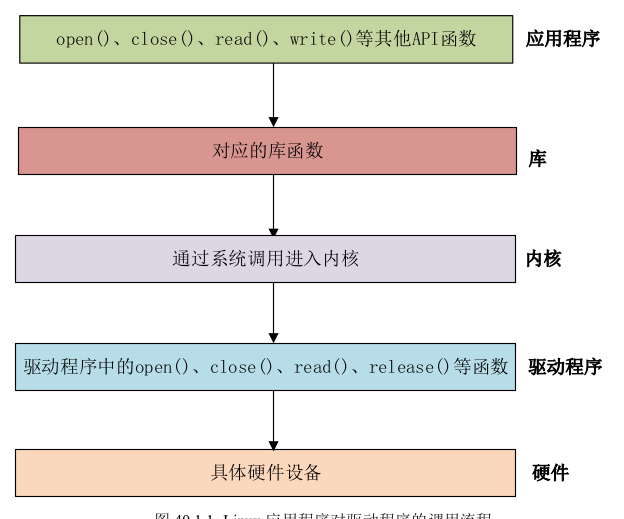

# 1.进程
操作系统正在执行的一个程序实例
查看所有进程
```bash
ps -ef --forest
```
以树状结构查看父子进程关系
```bash
top
```
杀死进程
kill PID
npx @deepseek-ai/dsh web
# linux文件系统
NFS（Network File System，网络文件系统）**是一种网络文件共享服务，可以让多台 Linux 电脑通过网络访问同一个目录，就像访问本地硬盘一样
因为 brltty 把你的开发板误认成了盲文点字设备。

brltty 是用于支持点字显示器的软件。一些点字设备也使用 CH340 USB 转串口芯片，和你的开发板拥有相同的 USB 标识：1a86:7523。它的设备匹配规则覆盖了这个标识，无法仅凭它区分两者
ssh -o HostKeyAlgorithms=+ssh-rsa -o PubkeyAcceptedAlgorithms=+ssh-rsa root@192.168.5.99
sudo minicom -D /dev/ttyUSB0 -b 115200
ifconfig eth0 192.168.5.99 netmask 255.255.255.0
ifconfig eth0

| 快捷键 | 功能 |
|---|---|
| Ctrl+A → Z | 显示帮助菜单 |
| Ctrl+A → X | 退出 Minicom |
| Ctrl+A → O | 打开配置菜单 |
| Ctrl+A → E | 开启/关闭本地回显 |
| Ctrl+A → L | 捕获串口日志 |
| Ctrl+A → Q | 退出但不复位串口 |
传文件 scp  chrdevbase.ko chrdevbaseApp imx6ull:/lib/modules/4.1.15-ge48931b1/
# day1
## 1.字符设备
字符设备就是按字节进行读写的设备  

字符设备加载与卸载  
insmod(加载驱动时xxx_init函数被调用)  
rmmod(卸载驱动时xxx_exit函数被调用)  
字符设备注册与注销    
注册时在*xxx_init*函数里注册 用**register_chrdev()**函数注册  
注销时在*xxx_exit*函数里注销 用**unregister_chrdev()**注销    
module_init(xxx_init);指定入口函数  
module_exit(xxx_exit);指定出口函数  
Linux设备号：主设备号表示某一个具体的驱动 次设备号表示使用该驱动的各个设备  
cat /proc/devices查看已使用设备号  
```bash
int alloc_chrdev_region(dev_t *dev, unsigned baseminor, unsigned count, const char *nam
e)
```
|变量 |	作用|
|---|---|
|ARCH := arm |	告诉 kbuild 用内核树里的 arch/arm/ 目录（决定头文件和体系结构代码）|
|CROSS_COMPILE := ...- |	告诉 kbuild 用哪个编译器，以及用哪套 ld/objcopy|
# day2
## 新字符设备驱动
1. register_chrdev 函数注册字符设备  
①、需要我们事先确定好哪些主设备号没有使用。  
②、会将一个主设备号下的所有次设备号都使用掉  
- 如果没有指定设备号的话就使用如下函数来申请设备号
```c
int alloc_chrdev_region(dev_t *dev, unsigned baseminor, unsigned count, const char *nam
e)
```
- 给定了设备的主设备号和次设备号注册设备号函数
```c
int register_chrdev_region(dev_t from, unsigned count, const char *name)
```
- 释放设备号函数
```c
void unregister_chrdev_region(dev_t from, unsigned count)
```
## 字符设备注册方法
- 使用cdev结构体表示字符设备
```c
struct cdev {
        struct kobject
        kobj;
        struct module
        *owner;
        const struct file_operations *ops;
        struct list_head
        list;
        dev_t
        dev;
        unsigned int
        count;
};
```
- 初始化字符设备
```c
void cdev_init(struct cdev *cdev, const struct file_operations *fops)
```
- 添加字符设备
```c
int cdev_add(struct cdev *p, dev_t dev, unsigned count)
```
- 删除字符设备
```c
void cdev_del(struct cdev *p)
```
加载驱动->创建设备节点
## mdev机制
mdev 来实现设备文件节点的自动创建与删除
udev busybox
- 创建类
```c
struct class *class_create (struct module *owner, const char *name)
```
- 删除类
```c
void class_destroy(struct class *cls);
```
- 创建设备
```c
struct device *device_create(struct class *class,
struct device *parent,
dev_t
devt,
void
*drvdata,
const char
*fmt, ...)
```
- 卸载设备
## 注册设备驱动完整过程
寄存器虚拟地址映射->创建设备号->初始化cdev(注册新设备)->创建类->创建设备(mdev 来实现设备文件节点的自动创建与删除)
## 注销设备过程
取消虚拟地址映射->注销设备->释放设备号->删除设备->删除类
# day3
1. MX6U IO 命名
# day4 11.23
## DTS DTB DTC

1. DTS:设备树源码文件 DTB：编译后二进制文件 DTC：编译工具
2. DTS语法
设备树头文件扩展名.dsti
3. 设备节点
“/”是根节点，每个设备树文件只有一个根节点  
子节点格式label: node-name@unit-address “unit-address”一般表示设备的地址或寄存器首地址
4. 节点的标准属性
#address-cells 和#size-cells 属性  
#address-cells 属性值决定了**子节点**reg属性中地址信息所占用的字长(32 位)，#size-cells 属性值决定了**子节点**reg 属性中长度信息所占的
字长(32 位)  (**补充：地址在按字节编址的系统中，一个地址对应1 Byte**)
adress-cells:**如果为2字节点高位和低位拼起来做地址**
ranges属性：ranges 属性值可以为空或者按照(child-bus-address,parent-bus-address,length) ranges 是一个地址映射/转换表  
length：子总线中有多少连续的地址范围可以通过 ranges 映射到父总线  
## linux内核 compatible 属性找到对应的设备的函数调用过程

| 内容 | dt_compat | 根节点 compatible |
|---|---|---|
| 定义位置 | mach-imx6ul.c | imx6ull-alientek-emmc.dts |
| 保存位置 | Linux 内核镜像 | DTB 文件 |
| 编译阶段 | 内核编译 | 设备树编译 |
| 编译命令 | make zImage | make dtbs |
| 使用阶段 | Linux 启动阶段 | Linux 启动阶段 |
| 作用 | 告诉内核支持哪些 SoC | 告诉内核当前是什么设备 |
## 向节点追加或修改内容
&某个节点
## 特殊节点
aliases：定义节点别名
chosen:将uboot中bootarg属性传入chosen节点
## Linux 内核解析 DTB 文件

## 设备树常用OF操作函数(linux/of.h)
查找节点的OF函数
查找子父节点的OF函数  
提取属性值的OF函数
# day5 11.24
## 主机端编译好dtb文件传到开发板
```bash
cd /home/fly/linux/temp/linux-imx-4.1.15-2.1.0-e48931b1-v2.8 ##在内核源码树下进行编译
make ARCH=arm CROSS_COMPILE=/usr/local/arm/gcc-linaro-4.9.4-2017.01-x86_64_arm-linux-gnueabihf/bin/arm-linux-gnueabihf- dtbs ##选择交叉编译器 实际编译使用dtc工具
```
1. of_iomap 函数用于直接内存映射
```c
void __iomem *of_iomap(struct device_node *np,int index)
```
# day6 11.25
## pinctrl子系统
①、获取设备树中 pin 信息。  
②、根据获取到的 pin 信息来设置 pin 的复用功能  
③、根据获取到的 pin 信息来设置 pin 的电气特性  
mux_reg：决定这个引脚用来做什么。  
conf_reg：决定这个引脚以什么电气特性工作  
1. PIN驱动程序
设备树中的 compatible 属性值会和 of_device_id 中字符串比较->platform平台驱动->imx6ul_pinctrl_probe函数执行->->imx_pinctrl_parse_groups 负责获取设备树中关于 PIN 的配置信息  
pinctrl_register，此函数用于向 Linux 内核注册一个 PIN 控制器
## gpio驱动程序
设备树中的 compatible 属性值会和 of_device_id 中字符串比较->platform平台驱动->mxc_gpio_probe()->(1)获取设备树节点(2)调用mxc_gpio_get_hw()函数获取寄存器资源(3)调用platform_get_resource函数获取GPIO基地址(4)内存映射(5)中断服务(6)bgpio_init()初始化 GPIO 控制器的操作结构体(6)gpiochip_add()将 I.MX6ULL 的 GPIO 控制器注册到 Linux GPIO 子系统
## of_match_table和设备树匹配
Linux 内核读取设备树节点的 compatible 属性，然后与驱动程序中 of_match_table 保存的兼容字符串进行比较  
设备树平台设备创建机制
# day7 11.26
## 为指针变量所指向的空间分配内存
定义一个指针变量只是为该变量分配了空间，它指向的空间需要手动分配内存


   